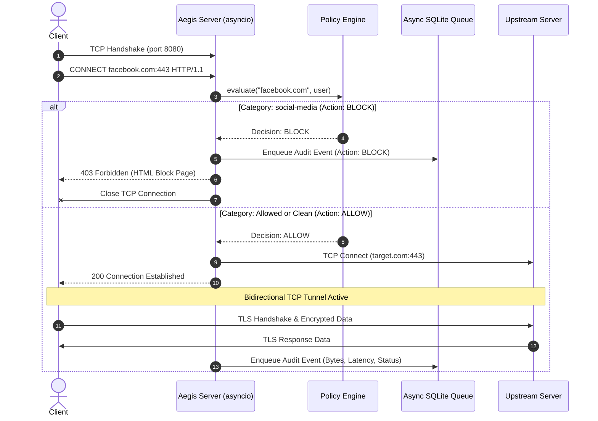

# Aegis Gate Architecture: Forward Proxy & Policy Filtering Gateway

An asynchronous HTTP/HTTPS forward proxy written in Python (`asyncio`) implementing RFC 7231 `CONNECT` tunneling, binary TLS SNI inspection, domain category filtering, and an administrative web console.

---

## 1. System Overview

A **Forward Proxy** sits between client applications (browsers, CLI tools, internal services) and the external Internet. Unlike a Reverse Proxy (which sits in front of a web server to handle load balancing and TLS termination), a Forward Proxy intercepts outbound traffic from clients to enforce domain policies, log access, and control egress connectivity.

```
+---------------+        +-------------------------------+        +----------------------+
| Client Device | -----> | Aegis Gate (Forward Proxy)    | -----> | External Web Server  |
| (Browser/CLI) |        | 1. Authentication Check       |        | (e.g. example.com)   |
+---------------+        | 2. Policy Engine (Block/Pass) |        +----------------------+
                         | 3. TLS SNI Packet Sniffing    |
                         | 4. Async Audit Queue          |
                         +-------------------------------+
                                      |
                         +-------------------------------+
                         | Web Admin Dashboard (Port 8081|
                         | - Live Stream  - Custom Rules |
                         | - Metrics      - Policy Sim   |
                         +-------------------------------+
```

---

## 2. Protocol Implementation Details

### A. HTTP Forward Proxying vs. HTTPS `CONNECT` Tunneling

#### Standard HTTP Proxying (RFC 7230)
1. The client sends an absolute URI in the HTTP request line:
   ```http
   GET http://example.com/index.html HTTP/1.1
   Host: example.com
   User-Agent: curl/8.0 ...
   ```
2. The proxy reads the full headers and path, evaluates the policy engine, strips hop-by-hop headers (`Proxy-Connection`), forwards the request to the upstream origin, and pipes back the HTTP response.

#### HTTPS `CONNECT` Tunneling (RFC 7231 § 4.3.6)
Because HTTPS traffic is encrypted end-to-end with TLS, the proxy cannot read HTTP paths or headers without performing full TLS termination (which requires installing a custom root CA on every client). Instead, RFC 7231 defines the `CONNECT` method:
1. Client sends:
   ```http
   CONNECT cdn.discordapp.com:443 HTTP/1.1
   Host: cdn.discordapp.com:443
   Proxy-Authorization: Basic dXNlcjpwYXNz
   ```
2. The proxy parses the requested host and port and checks the **Policy Engine**:
   - **If BLOCKED:** The proxy immediately responds with `HTTP/1.1 403 Forbidden`, delivers an HTML security block page, and terminates the socket.
   - **If ALLOWED:** The proxy establishes an upstream TCP socket to the destination:
     ```http
     HTTP/1.1 200 Connection Established
     Proxy-Agent: AegisGate/1.0
     ```
3. Once the `200` response is sent, the proxy transitions into a bidirectional streaming byte pipe (`tunnel.py`).

---

### B. TLS SNI (Server Name Indication) Sniffing Without Decryption

A known issue with blind `CONNECT` proxies is that a client can issue `CONNECT allowed-site.com:443`, but inside the encrypted tunnel, initiate a TLS handshake for `prohibited-site.com`.

To detect this without breaking encryption, Aegis Gate implements an in-memory **TLS ClientHello binary parser** (`proxy/sni_parser.py`):
1. Immediately upon establishing the tunnel, the proxy reads the first packet sent by the client.
2. It parses the binary TLS Record Header (`0x16` Handshake) and Handshake Layer (`0x01` ClientHello).
3. It navigates variable-length fields (random, session ID, cipher suites, compression methods) to locate TLS Extension `0x0000` (Server Name Indication, RFC 6066).
4. It extracts the raw destination hostname directly from the binary stream without terminating TLS.
5. If the extracted SNI hostname violates policy or conflicts with the CONNECT target, the proxy closes the socket.

---

## 3. Concurrency & Data Flow



### Event-Driven Concurrency Model
- Built on Python's native `asyncio` streams (`asyncio.start_server`, `StreamReader`, `StreamWriter`).
- Benchmark results on single machine:
  - **Policy Rejection Path (fast 403 drop):** ~2,616 requests/sec, 18.89 ms median latency ($p50$).
  - **Upstream Forwarding Path (end-to-end proxying):** ~1,392 requests/sec, 35.13 ms median latency ($p50$).

### Asynchronous Batched Audit Queue
Database disk writes are synchronous I/O operations that would block the event loop if executed inline. To prevent latency spikes:
1. When a connection completes or is blocked, an audit entry is pushed into an in-memory `asyncio.Queue`.
2. A background worker task consumes entries in batches (up to 100 entries per batch) and writes them to SQLite inside a single transaction using `executemany` via `asyncio.to_thread()`.

---

## 4. Policy Engine Evaluation Pipeline

Evaluation follows a strict 4-tier precedence hierarchy:

```
[Incoming Request: host, path, user]
                 |
                 v
   +-----------------------------+
   | 1. Per-User Custom Rules    | ---> Match? ---> Enforce Decision
   +-----------------------------+
                 | No match
                 v
   +-----------------------------+
   | 2. Global Custom Rules      | ---> Match? ---> Enforce Decision
   |    (Exact, Wildcard, Regex) |
   +-----------------------------+
                 | No match
                 v
   +-----------------------------+
   | 3. Category Database        | ---> Match? ---> Enforce Decision
   |    (Malware, Social, etc.)  |
   +-----------------------------+
                 | No match
                 v
   +-----------------------------+
   | 4. Default Fallback Policy  | ---> Return ALLOW / BLOCK
   +-----------------------------+
```
