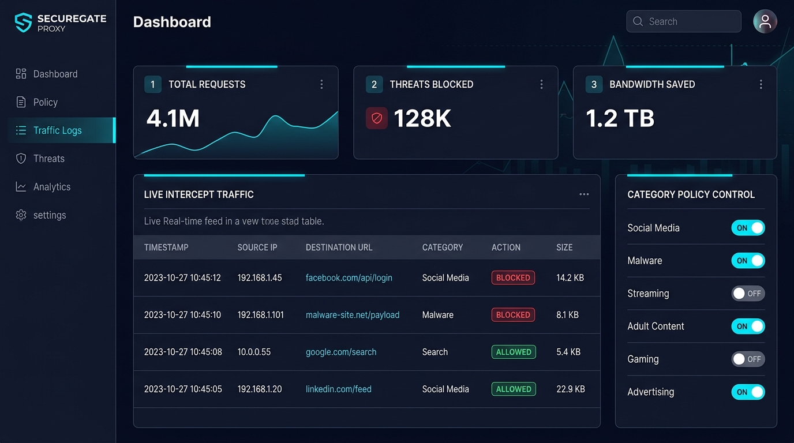

# Aegis Gate: Forward Proxy with URL & Domain Filtering

[](https://www.python.org/)
[](https://docs.python.org/3/library/asyncio.html)
[](tests/)
[](LICENSE)

An asynchronous HTTP/HTTPS forward proxy written in Python (`asyncio`). It intercepts client traffic, handles RFC 7231 `CONNECT` tunneling for HTTPS, inspects TLS Server Name Indication (SNI) packets, evaluates requests against configurable domain and category policies, logs access events asynchronously, and provides a web-based administration console.

---

## Architecture Overview

A forward proxy handles outbound client traffic rather than incoming server traffic. Aegis Gate is structured into five decoupled modules:

```
+---------------+        +-------------------------------------------------------+        +----------------------+
| Client Device | -----> |                      AEGIS GATE                       | -----> | Destination Server   |
| (Browser/CLI) |        |  +-------------------------------------------------+  |        | (e.g. example.com)   |
+---------------+        |  | TCP Listener (asyncio.start_server, port 8080)  |  |        +----------------------+
                         |  +-------------------------------------------------+  |
                         |                           |                           |
                         |  +-------------------------------------------------+  |
                         |  | Policy Engine (Exact, Wildcard, Regex, Category)|  |
                         |  +-------------------------------------------------+  |
                         |          | (Allowed)                  | (Blocked)     |
                         |          v                            v               |
                         |  +-------------------+       +---------------------+  |
                         |  | CONNECT Tunnel /  |       | 403 Forbidden       |  |
                         |  | Upstream Forward  |       | HTML Block Page     |  |
                         |  +-------------------+       +---------------------+  |
                         |          |                            |               |
                         |          +-------------+--------------+               |
                         |                        v                              |
                         |  +-------------------------------------------------+  |
                         |  | Asynchronous Batch Queue -> SQLite (proxy.db)   |  |
                         |  +-------------------------------------------------+  |
                         +------------------------|------------------------------+
                                                  v
                                      +-----------------------+
                                      | Web Console (port 8081|
                                      +-----------------------+
```

1. **Proxy Core (`proxy/`):** Listens for incoming client TCP sockets, reads initial HTTP request lines, evaluates policies, and handles either regular HTTP proxying or bidirectional `CONNECT` tunneling.
2. **TLS SNI Parser (`proxy/sni_parser.py`):** An in-memory binary parser for TLS 1.2/1.3 `ClientHello` packets (RFC 5246, RFC 6066). Extracts the destination hostname directly from the binary stream without terminating TLS.
3. **Policy Engine (`policy/`):** Evaluates requests in order: per-user rules -> exact domain matches -> wildcard matches (`*.reddit.com`) -> regex rules -> threat category database (`malware`, `social-media`, `gambling`, etc.) -> default fallback action.
4. **Storage & Audit Layer (`storage/`):** Implements an in-memory queue (`asyncio.Queue`) drained by a background worker into SQLite via `executemany` batches, preventing synchronous disk I/O from stalling the proxy event loop.
5. **Admin Dashboard (`dashboard/`):** An `aiohttp` web application providing real-time log inspection, 1-click category enforcement toggles, custom rule management, and a policy evaluation simulator.



---

## Performance Benchmarks

The benchmark suite (`benchmark/benchmark.py`) tests two distinct code paths under 50 concurrent async workers:

1. **Policy Rejection Path (Blocked Traffic):** Measures the proxy's in-memory policy lookup and fast 403 response generation without upstream socket creation.
2. **Upstream Forwarding Path (Allowed Traffic):** Measures end-to-end proxying against a local mock HTTP server, including upstream TCP socket connection, request forwarding, response piping, and socket teardown.

### Benchmark Results (50 Concurrent Workers, 500 Requests per test)

| Metric | Policy Rejection Path (Blocked) | Upstream Forwarding Path (Allowed) |
| :--- | :--- | :--- |
| **Throughput** | **2,616 requests/sec** | **1,392 requests/sec** |
| **Median Latency ($p50$)** | **18.89 ms** | **35.13 ms** |
| **90th Percentile ($p90$)** | **21.57 ms** | **38.99 ms** |
| **95th Percentile ($p95$)** | **22.31 ms** | **40.08 ms** |
| **99th Percentile ($p99$)** | **22.60 ms** | **40.39 ms** |
| **Average Latency** | **18.42 ms** | **34.35 ms** |
| **HTTP Status Code** | 100% `403 Forbidden` | 100% `200 OK` |

To reproduce these numbers locally:
```bash
python benchmark/benchmark.py -c 50 -n 500 --mode all
```

---

## Known Limitations & Design Trade-offs

Being honest about architectural boundaries is essential when discussing network systems:

1. **No Full TLS Interception (No MITM / Deep Packet Inspection):**
   Aegis Gate does not terminate TLS sessions. It inspects only the outer `CONNECT` request and the unencrypted `ClientHello` SNI. Consequently, it cannot inspect inner HTTP request methods, query strings, headers, or POST payloads on HTTPS traffic without deploying a custom private root CA to every client machine.

2. **Encrypted Client Hello (ECH / RFC 8744):**
   Modern browsers and TLS implementations are transitioning to Encrypted Client Hello (ECH), which encrypts the SNI extension inside an outer `ClientHello`. When ECH is negotiated, passive SNI sniffing cannot extract the inner destination hostname unless ECH DNS records (`HTTPS` / `SVCB` resource records) are stripped or blocked at the network resolver.

3. **SNI Spoofing and Domain Fronting:**
   While the proxy checks both the HTTP `CONNECT` target and the TLS SNI extension for consistency, a sophisticated client can technically craft mismatched SNI fields or route through shared CDNs (domain fronting). Mitigating this without full TLS decryption requires strict DNS-to-IP validation or IP-layer egress firewalls.

4. **SQLite Concurrency Ceiling:**
   Access logs are batched into SQLite via an asynchronous queue to avoid event loop blocking. While effective for single-instance workloads, SQLite relies on file-level write locking. Scaling to multi-instance or high-throughput production would require replacing SQLite with a distributed write-optimized store like Redis, PostgreSQL, or ClickHouse.

5. **Single-Process Event Loop:**
   Python's Global Interpreter Lock (GIL) and single-threaded event loop bind processing to a single CPU core. Multi-core scaling requires spawning multiple worker processes behind a Layer 4 load balancer using socket reuse (`SO_REUSEPORT`).

---

## Quickstart

### Prerequisites
- Python 3.10+ (tested on Python 3.12)
- Git

### 1. Installation
```bash
git clone https://github.com/kr307/secure-forward-proxy.git
cd secure-forward-proxy

pip install -r requirements.txt
```

### 2. Running the Proxy
```bash
python main.py
```
- **Proxy Server:** `http://0.0.0.0:8080`
- **Admin Dashboard:** `http://localhost:8081`

---

## Testing Interception

### Test 1: Blocked Category (Social Media)
```bash
curl -x http://127.0.0.1:8080 -i http://facebook.com/
```
**Response:**
```http
HTTP/1.1 403 Forbidden
Content-Type: text/html; charset=utf-8
X-Proxy-Action: BLOCKED
X-Proxy-Category: social-media
...
[HTML Policy Block Page]
```

### Test 2: Allowed Forwarding
```bash
curl -x http://127.0.0.1:8080 -I http://example.com/
```

### Test 3: HTTPS CONNECT Tunneling
```bash
curl -x http://127.0.0.1:8080 -I https://www.bbc.com/
```

---

## Automated Test Suite

```bash
python -m pytest tests/ -v
```

All 12 unit and integration tests verify:
- Binary TLS ClientHello SNI parsing and truncation handling
- Subdomain inheritance and wildcard precedence
- HTTP GET blocking and custom header verification
- HTTPS CONNECT blocking and connection rejection

---

## Project Structure

```
secure-forward-proxy/
├── proxy/
│   ├── server.py              # Asyncio TCP socket listener & worker pool
│   ├── handler.py             # HTTP/CONNECT protocol parser & block page generator
│   ├── sni_parser.py          # Binary TLS ClientHello SNI extractor (RFC 6066)
│   └── tunnel.py              # Bidirectional TCP streaming pipe
├── policy/
│   └── engine.py              # Multi-tier policy & category evaluation engine
├── storage/
│   └── db.py                  # Asynchronous SQLite queue & query layer
├── dashboard/
│   ├── app.py                 # Admin dashboard REST API (aiohttp)
│   └── templates/
│       └── index.html         # Web management console
├── config/
│   ├── config.yaml            # Server ports, buffer, and auth settings
│   └── categories.yaml        # Categorized domain intelligence lists
├── benchmark/
│   └── benchmark.py           # Concurrency and latency load testing tool
├── tests/
│   ├── test_proxy.py          # HTTP GET & HTTPS CONNECT interception tests
│   ├── test_policy.py         # Category & wildcard rule precedence tests
│   └── test_sni.py            # TLS binary packet parsing tests
├── docs/
│   └── dashboard_preview.png  # Dashboard console interface preview
├── Dockerfile                 # Container definition
├── docker-compose.yml         # Container orchestration
├── requirements.txt           # Python dependencies
├── ARCHITECTURE.md            # Protocol mechanics and sequence diagrams
└── main.py                    # Application entry point
```

---

## License

Distributed under the MIT License. See [LICENSE](LICENSE) for details.
